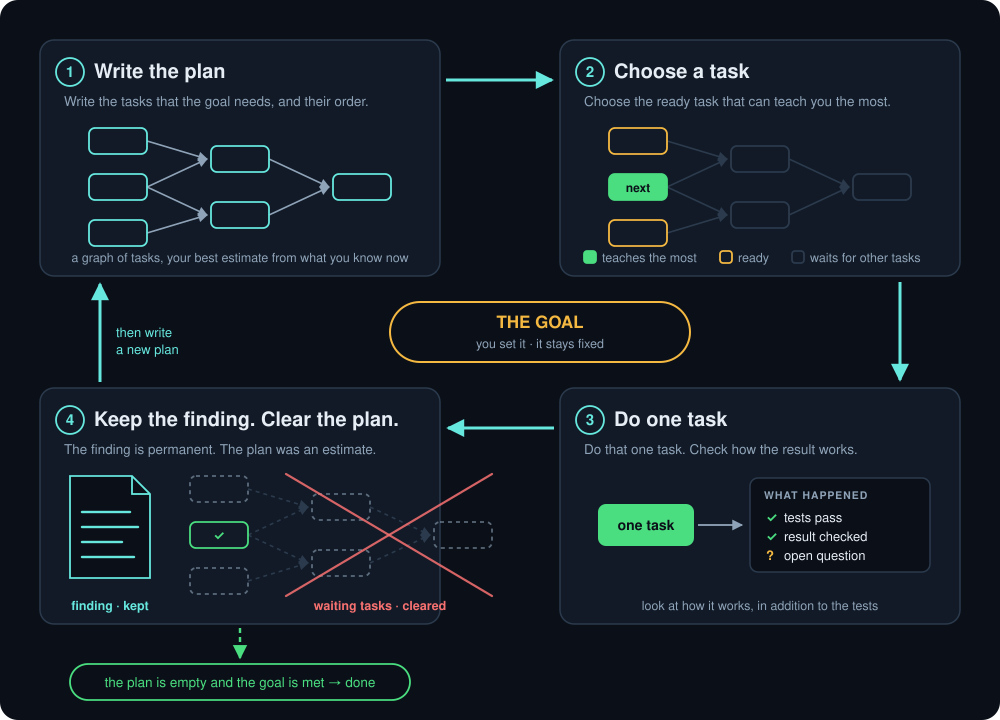

# Agentic Agile

**An agent loop that automates what agile was supposed to be.**

[](https://github.com/msmfai/agentic-agile/actions/workflows/ci.yml)
[](LICENSE)

Agentic Agile works with Claude Code, Codex, and OpenCode.

Agentic Agile is a maximally flexible loop for agents that work toward a
long-horizon goal, and a tool that runs the loop. It is made for work that
takes many tasks and many sessions, where the agent learns as it goes.
Examples are building software, research, and debugging. The loop has one
requirement. The goal is well defined, with a condition that shows when it is
met.

You set the goal. The agent writes a plan, which is its assumption about what
work is needed and in what order. It does the task that will teach it the most
and records the result. Then it writes the plan again with that result
included. It repeats this until the goal is met.

<p align="center">
  
</p>

## Why

Plans usually change after work starts, because the first tasks show things
that the plan assumed. The loop is built for this. The agent writes the plan
again after each task, and an agent can do that in a few minutes.

Agentic Agile follows three rules.

### 1. Write a new plan after every task

The goal is yours and it stays fixed. The findings from each task are
permanent. The plan is the agent's best estimate, so the agent clears it when
a task is done and writes a fresh one.

A fresh plan starts from the goal, the current code, and the findings. Every
task in it is justified by what you know today.

### 2. Every task says why it is there

Each task records what to do, how to tell that it is done, and why it helps to
meet the goal. When the agent starts a task, it sees the goal, the task, and
the reason. The purpose stays in view through all of the work.

### 3. Do the task that teaches the most

Some tasks are ready to start. The agent chooses the task whose result can
change what you build next. A short experiment that tests the approach goes
first, because its result shapes all the later work.

## Quick start

```sh
curl -fsSL https://raw.githubusercontent.com/msmfai/agentic-agile/main/install.sh | sh -s -- all
```

This command installs Agentic Agile into each supported agent on your
computer. It needs Python 3.9 or later and Git. It runs on macOS and Linux.

Then open a project and give your agent a goal.

> Use Agentic Agile for this goal. Migrate the service to Postgres 17 with zero downtime.

Your agent can also do the installation.

> Install Agentic Agile. Follow https://github.com/msmfai/agentic-agile/blob/main/INSTALL.md

## How it works

Your agent runs these commands for you. The command is `agentic-agile`, and
`agile` is the short name for it.

### Set the goal

```sh
agentic-agile init \
  --goal "Every load goes to a depot that can accept it" \
  --done "The planner flags a refrigerated load on a route to a dry depot before the route is committed"
```

### Write the plan

Each task has a description, a done condition, and a reason.

```sh
agentic-agile add trial --kind investigation --title "One-rule trial" \
  --objective "Run one chilled load through the planner with a specialist that knows one depot rule" \
  --done "The trace shows when the warning arrived, compared to the route commit" \
  --why "The result tells us if the specialist design works. All later tasks depend on it."

agentic-agile add inputs --title "Production shipment inputs" \
  --objective "Parse real shipment files" --done "Fixture files load" \
  --why "The pilot runs on real inputs"

agentic-agile add pilot --title "Pilot with three dispatchers" \
  --objective "Run the specialist on live plans" --done "Three dispatchers used it for a day" \
  --why "Real dispatch work shows how dispatchers use the warnings"

agentic-agile depends pilot trial --why "The pilot uses a design that has worked once"
agentic-agile depends pilot inputs
```

```console
$ agentic-agile tree
◆ Every load goes to a depot that can accept it
├─ ◇ inputs (task) Production shipment inputs  ready
├─ ○ pilot (task) Pilot with three dispatchers  requires inputs, trial
└─ ◇ trial (investigation) One-rule trial  ready
```

### Start the task that teaches the most

Two tasks are ready. The result of the trial decides the design, so the trial
is first.

```console
$ agentic-agile next trial --why "The result decides the design"
```

### Complete the task and record the finding

The command saves the finding and clears the rest of the plan.

```console
$ agentic-agile complete trial --learned "Lookup on request worked. The unprompted warning arrived after the lookup. Next we test if unprompted help can arrive first."
Completed trial. Finding saved.
Cleared the rest of the plan (2 tasks). Write a new plan from what you learned.
```

The agent writes a new plan from the finding. The new plan starts with a real
specialist, because the finding made that the most important question. The
loop continues until a new plan is empty and the goal is met.

### Let the run do the loop

```sh
agile run --background    # starts the loop detached and returns at once
agile run --wait          # follows it, and exits 20 while it still works
agile run --status        # one line with the step and the running tasks
```

The run uses a fresh planner for each plan, a fresh worker for each task, and
a fresh reviewer when every task in a round said `same`. It stops when a
person is needed or the goal is met, and its exit code says which. A goal with
a check, set by `init --check COMMAND`, is met only when the check passes.
[docs/commands.md](docs/commands.md) lists each exit code and what to do next.

Each planner, reviewer and worker starts fresh. Its only input is the goal,
the findings and the project, so each plan comes from the evidence alone.

The run watches every agent. When an agent is silent for two minutes with no
command running, or a task runs past its expected time, the run keeps working
and sends a report with the evidence to your session. You decide with your
agent whether to stop the task, give it more time, or dismiss the report.

## Features

### The agent works until the goal is met

When the agent reaches a stopping point with work remaining, it gets its next
instruction and continues. You control this with `agentic-agile goal pause` and
`agentic-agile goal resume`.

### You see what the agent does

Claude Code shows a status bar and a plan view. OpenCode shows a sidebar.
`agentic-agile watch` works in any terminal.

```text
◆ Agentic Agile · trial · ▱▱▱▱▱ 0/3 · ● goal active
```

| | Status | Full plan |
| --- | --- | --- |
| **Claude Code** | Bar above the prompt, with Pause and Graph buttons | `/agile-graph` pane |
| **OpenCode** | Indicator beside the prompt | Sidebar |
| **Codex** | One line after each turn | `agentic-agile watch` in a side pane |

### All data is in plain files

The goal, each plan, each reason, and each finding are JSON files in
`.agentic-agile/`. You can read, compare, and commit them.

### A new session continues the work

A new or compacted session gets the goal and the findings, so it starts with
everything it needs.

### Checks are enforced

Attach a command to a task. The task is complete when the command passes.

## Install options

```sh
agentic-agile install claude                     # all projects, with the UI
agentic-agile install opencode --scope project   # this project
agentic-agile install codex --variant lite       # instructions and hooks as plain files
agentic-agile install all --print                # preview the changes
agentic-agile uninstall claude
```

The `full` variant includes the UI. The `lite` variant installs the
instructions and the hooks as plain files that you can edit. You can install
each variant for all projects or for one project. [INSTALL.md](INSTALL.md) has
the details.

## Documentation

| Document | Contents |
| --- | --- |
| [INSTALL.md](INSTALL.md) | The install options, and steps that an agent can follow |
| [docs/commands.md](docs/commands.md) | All commands |
| [docs/protocol.md](docs/protocol.md) | The exact rules and the data format |
| [AGENTS.md](AGENTS.md) | A map of the code. Give it to your agent when you want to change something. |

## Status

This is an early release, version 0.1. The core and the installers have tests.
The agent integrations follow the plugin APIs of each agent as those APIs
change. Issues and pull requests are welcome. [CONTRIBUTING.md](CONTRIBUTING.md)
explains how to contribute.

## License

[MIT](LICENSE)
